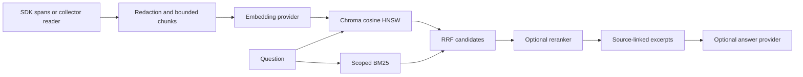

# SDK log RAG

Add search and evidence-grounded answers to your application with
`model-worklog-sdk/rag`. No VS Code extension is required. The application owns
authentication, project access and the lifecycle of its derived index.

The pipeline combines **Chroma cosine HNSW**, **BM25**, **reciprocal rank fusion
(RRF)** and an optional local cross-encoder reranker. Embeddings and reranking run
on CPU in the example; no model account or API key is needed.



## Run the example

For automatic setup on macOS or glibc Linux (Windows: WSL2), run from the
`feat/local-log-rag` checkout:

```sh
bash scripts/run-rag.sh
```

It checks Node >=22.13, Python 3.13 and all JavaScript/Python dependencies,
installs missing components locally, builds, starts isolated services, records a
sample refund failure and opens a terminal prompt for questions. No model account
is needed. Type `exit` or press Ctrl+C to stop. The sample index is temporary,
and answers show captured log excerpts with citations.

Use `--no-chat` for one sample answer, `--check` for the complete live quality
gate, or `--setup-only` to prepare dependencies without starting services.
The script requires Bash, tar, and curl or wget. Missing Node is downloaded from
nodejs.org and SHA-256 checked; missing Python is provisioned with
[uv](https://docs.astral.sh/uv/guides/install-python/). Private runtimes live in
`.cache/rag-tools/`, Python packages in `.venv-rag/`, and Node packages in
`node_modules/`. It does not use sudo or change shell profiles. Existing compatible
runtimes and downloaded models are reused. `MODEL_WORKLOG_RAG_PYTHON` can select
an existing Python 3.13 environment; `MODEL_WORKLOG_MODEL_CACHE` changes the cache.

The launcher prints the branch/commit and writes diagnostic logs in `output/rag/`.
It cleans up its own local services and temporary data on exit. Do not run it
alongside other builds/tests in the same checkout.

### Manual setup

Use Node >=22.13 and Python 3.13. From the repository root:

```sh
npm ci
npm run build
python3.13 -m venv .venv-rag
.venv-rag/bin/pip install -r examples/rag/requirements.txt
```

Start the two local services in separate terminals:

```sh
.venv-rag/bin/chroma run --host 127.0.0.1 --port 18561 --path .cache/chroma
```

```sh
.venv-rag/bin/python examples/rag/local_embeddings.py \
  --port 18562 --cache-dir .cache/rag-models --reranker
```

First startup downloads model weights. Then run the SDK-only example:

```sh
MODEL_WORKLOG_RERANK_URL=http://127.0.0.1:18562/v1/rerank npm run rag:example
```

It records a handled refund failure, indexes it, and asks a paraphrased question
with source citations. The example is [quickstart.mjs](../examples/rag/quickstart.mjs).
Windows uses `.venv-rag\Scripts\python.exe` and `.venv-rag\Scripts\chroma.exe`.

## Integrate

```ts
import { createModelLogger } from 'model-worklog-sdk';
import {
  LogRag, LogRagTraceExporter, ChromaLogVectorStore,
  OpenAiLogEmbedder, HttpLogRagReranker,
} from 'model-worklog-sdk/rag';

const rag = new LogRag({
  store: new ChromaLogVectorStore({
    url: 'http://127.0.0.1:18561', collection: 'my-agent-logs',
  }),
  embedder: new OpenAiLogEmbedder({
    endpoint: 'http://127.0.0.1:18562/v1/embeddings',
    model: 'BAAI/bge-small-en-v1.5',
    queryPrefix: 'query: ', documentPrefix: 'passage: ',
  }),
  reranker: new HttpLogRagReranker('http://127.0.0.1:18562/v1/rerank'),
});

const logger = createModelLogger({
  projectId: 'payments', serviceName: 'my-agent',
  exporter: new LogRagTraceExporter(rag),
  privacy: { mode: 'redacted-content' }, exportTimeoutMs: 30_000,
});

// Instrument operations with logger.trace / logger.wrap as usual.
// Content/results still need explicit capture and serialization.
// Before querying a completed run, await logger.flush() or logger.shutdown()
// and inspect the returned delivery status.

const result = await rag.ask({
  projectId: 'payments', question: 'Why did the refund fail?',
  mode: 'hybrid', limit: 5, signal: AbortSignal.timeout(45_000),
});
console.log(result.answer, result.hits, result.coverage);
```

Metadata-only capture remains the logger default; the example explicitly opts
into content. `LogRagTraceExporter` can optionally delegate to another
`TraceExporter` as its second argument, including `HttpTraceExporter`, to retain
the same spans in the collector. Failed indexing is reported through normal SDK
delivery/retry diagnostics; it does not fabricate successful delivery.

To import existing collector logs, use a scoped **reader** credential:

```ts
import { LocalSupervisorClient } from 'model-worklog-sdk';
import { CollectorLogSource } from 'model-worklog-sdk/rag';

const client = await LocalSupervisorClient.fromLocalEnvironment();
const source = new CollectorLogSource(client);
await rag.sync(source, { projectId: 'payments' }, { prune: true });
```

`MODEL_WORKLOG_TOKEN` supplies the reader; otherwise the local operator token is
used. Writer credentials cannot read logs. `sync(..., { prune: true })` removes
indexed spans absent from a complete source scan and refuses pruning from a
partial scan. Collector pagination is not an atomic execution snapshot.

## API and extension points

| API | Purpose |
| --- | --- |
| `indexSpans(records)` | Index validated `StoredTraceSpan` batches; retain latest revisions. |
| `search(request)` | Return ranked chunks, source identities, component scores, coverage and timings. |
| `ask(request)` | Return cited excerpts, or an optional provider-generated answer. |
| `sync(source, scope, options)` | Import retained logs through a custom or collector source. |
| `delete(scope)` | Remove derived index data for a project, trace or span. |

Requests require `projectId`. Optional `traceId`, `spanId`, `toolName`, `since`,
`until`, bounded conversation `history`, `mode` (`bm25`, `vector`, `hybrid`),
`limit` (1–20), and `signal` control retrieval. Earlier user questions can resolve
follow-ups; earlier assistant claims never become source evidence.

Replace `LogRagEmbedder`, `LogRagVectorStore`, `LogRagReranker`, `LogRagSource` or
`LogRagAnswerer` to integrate your own infrastructure. `OpenAiLogRagAnswerer`
supports an explicitly configured compatible chat endpoint; without an answerer,
`ask` returns source excerpts. Invalid citations/provider failures fall back to
excerpts. This validates citation identity, not the truth of every generated claim.

## Retrieval choices

- Chroma stores normalized embeddings and provenance. HNSW defaults: cosine,
  `ef_construction=200`, `ef_search=128`, `max_neighbors=32`.
- BM25 scores the scoped corpus with `k1=1.2`, `b=0.75`, preserving complete file
  paths/tool identifiers alongside split tokens. Default candidate depth is 100.
- RRF uses `k=60`; lexical/vector weights are 0.65/0.35 for identifiers and
  0.35/0.65 for ordinary language. `lexicalWeight` and `rrfK` are configurable.
- Optional reranking blends relevance and cosine scores, preserves a configurable
  semantic recall floor, and gives retained failed spans a small boost for
  failure questions. `rerankVectorWeight`, `minRerankScore`, `rerankRecallFloor`
  and `failureBoost` are adjustable. Scores are not calibrated probabilities.
- Repeated content is deduplicated in results; each span contributes at most two
  chunks. Exact counts use distinct indexed span identities, never top-k samples.

The general example leaves score rejection disabled. The evaluation uses a
specific rejection threshold and semantic recall floor tuned to its labelled
corpus. Calibrate those options on your application's logs: a threshold that
works there can reject relevant short passages elsewhere.

The tested local profile uses **BAAI/bge-small-en-v1.5** (384 dimensions) and
**ms-marco-MiniLM-L-12-v2**. A larger embedding model and another reranker did not
improve this corpus. Codex CLI is a coding/chat runtime, not an embedding API;
the local embedding model avoids model-account dependencies for indexing.

## Quality checks

```sh
npm run test:rag
npm run test:rag:live
```

The live command starts isolated services, tests capture/import/deletion, measures
BM25/vector/RRF/reranked retrieval against labelled sources, and checks HNSW
neighbours against an exact cosine oracle. Set `MODEL_WORKLOG_RAG_PYTHON` for a
different virtualenv and `MODEL_WORKLOG_MODEL_CACHE` for a shared model cache.
Reports and service logs are written to `output/rag/`; temporary stores are removed.

See [measured results and limitations](rag-evaluation.md). These are regression
tests on a curated corpus, not a guarantee of perfect recall on arbitrary logs.

## Operational limits

Capture redaction runs before indexing. Discarded content and hidden reasoning
cannot be recovered. Chunking retains up to eight 1,750-character passages per
span, prioritizing outputs/events across long inputs; shortening is explicit.
BM25 scans at most 20,000 scoped chunks by default (`maxCorpusChunks` can change
this); exceeding the bound marks retrieval and indexed aggregates partial.

Use a single index writer per collection. Chroma and the collector are separate
stores: collector deletion does not automatically delete an independently managed
Chroma copy. Wire `delete` into retention or run complete scoped `sync` with
pruning. Index revision cleanup is idempotent, but this is not a distributed
transaction. Use a new collection when the embedding model/version/prefixes change.

Application authorization must precede project selection; metadata filters are
not an authentication system. Keep local services on loopback. Configured remote
embedding/answer endpoints receive bounded redacted data and remain trusted
providers. Model weights are downloaded separately and retain upstream licenses.
